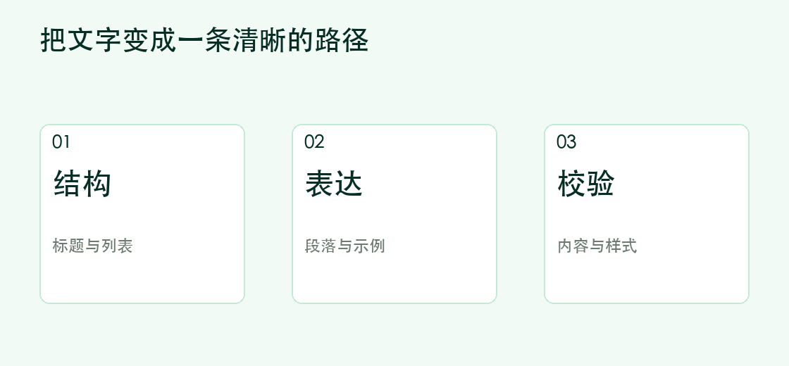

# CommonMark 核心语法示例

本文采用 CommonMark 0.31.2 核心语法。示例围绕一篇写作笔记展开，可直接交给兼容 CommonMark 的工具渲染。

Markdown 并不存在覆盖所有编辑器扩展的唯一“官方版”。本文以 CommonMark 作为明确的标准基准，不包含 GFM、数学公式或其他插件语法。

规范地址：<https://spec.commonmark.org/0.31.2/>

## 1. 段落与换行

这是第一个段落。普通文字无需额外标记。

这是第二个段落。段落之间通过空行分隔。

这两行之间只有一个普通换行，
它属于软换行，不等同于强制换行。

这一行末尾有两个空格。  
因此下一行使用硬换行。

这一行末尾有一个反斜杠。\
因此下一行也使用硬换行。

## 2. ATX 标题

标题使用一至六个井号，井号后面需要空格。

### 三级标题

这里是三级标题下的正文。

#### 四级标题

这里是四级标题下的正文。

##### 五级标题

这里是五级标题下的正文。

###### 六级标题

这里是六级标题下的正文。

### 带可选闭合井号的标题 ###

末尾的闭合井号是可选的，不属于标题文字。

下面的代码展示全部六个层级，包括本文封面已经使用的一级标题。

```markdown
# 一级标题
## 二级标题
### 三级标题
#### 四级标题
##### 五级标题
###### 六级标题
```

## 3. Setext 标题

Setext 一级标题
==============

标题文字的下一行使用等号，表示一级标题。

Setext 二级标题
--------------

标题文字的下一行使用短横线，表示二级标题。

## 4. 强调与加粗

用 *星号强调*，也可以用 _下划线强调_。

用 **双星号加粗**，也可以用 __双下划线加粗__。

用 ***粗体与强调组合***，也可以用 ___下划线组合___。

强调内部可以包含 **粗体中的 *强调文字***，以及 *强调中的 **粗体文字***。

标记是否生效与标记两侧的空白、标点及位置有关，不是任意一对星号或下划线都会形成强调。

## 5. 分隔线

下面分别使用星号、短横线和下划线形成分隔线。

***

---

___

标记之间也可以带空格。

* * *

- - -

_ _ _

分隔线需要至少三个同类标记。短横线紧跟在正文下一行时，可能被识别为 Setext 二级标题，因此这里使用空行分隔。

## 6. 引用

> 先确定读者的问题，再组织文章结构。

引用可以包含多个段落。

> 第一个引用段落。
>
> 第二个引用段落。

引用也可以嵌套。

> 外层引用。
>
> > 内层引用。

引用内部可以包含标题、列表及代码。

> ### 引用中的标题
>
> - 第一个要点。
> - 第二个要点。
>
> ```text
> 引用中的代码内容。
> ```

## 7. 无序列表

无序列表可以使用短横线、加号或星号。下面用三个独立列表展示。

- 明确文章主题。
- 收集支持材料。

+ 完成第一版草稿。
+ 调整段落顺序。

* 检查表达是否清晰。
* 检查示例是否准确。

### 嵌套列表

- 写作准备。
  - 确定读者。
  - 确定目标。
    - 用一句话描述预期收益。
- 内容组织。
  - 安排章节。
  - 选择示例。

## 8. 有序列表

1. 确定文章的问题。
2. 给出具体的方法。
3. 使用示例进行解释。

列表可以从其他数字开始。

7. 第一项从七开始。
8. 第二项继续排列。

数字后面也可以使用右括号。

1) 第一项。
2) 第二项。

最终显示的编号由列表起始数字与渲染器决定，不应依靠每个源码数字制造任意跳号。

### 混合嵌套

1. 第一阶段：写作准备。
   - 明确文章受众。
   - 收集相关材料。
2. 第二阶段：完成草稿。
   1. 写出章节标题。
   2. 填写段落内容。

### 多段列表项

- 第一项的首个段落。

  第一项的第二个段落，使用缩进保持归属。

- 第二项的首个段落。

  第二项的第二个段落。

### 列表中的代码

1. 执行示例程序。

   ```python
   print("hello")
   ```

2. 检查输出结果。

## 9. 行内代码

字段名称可以写成 `article_title`。

代码中的标记不会被当成强调，例如 `**这不是粗体**`。

如果内容包含一个反引号，可以使用两个反引号作为边界：`` `example` ``。

如果内容包含连续两个反引号，可以使用三个反引号作为边界：``` ``example`` ```。

## 10. 围栏代码块

### 反引号围栏

```python
def describe(title):
    return {"title": title, "ready": bool(title)}

print(describe("写作笔记"))
```

### 波浪线围栏

~~~json
{
  "title": "写作笔记",
  "ready": true
}
~~~

### 无语言标签

```
保留缩进、空行及特殊字符。
    这一行有四个空格。

<article> & "text" **not emphasis**
```

### 围栏中包含其他围栏

````markdown
```python
print("内部围栏作为代码展示")
```
````

围栏至少使用三个同类字符。结束围栏必须使用相同字符，长度不能短于开始围栏。

开头围栏后的内容称为信息字符串。CommonMark 本身不规定语法高亮机制；语言名称常由渲染器用于高亮。

## 11. 缩进代码块

下面的代码使用四个空格缩进。它与前面的段落通过空行分隔。

    const article = {
        title: "写作笔记",
        ready: true
    };

    console.log(article.title);

## 12. 内联链接

普通链接：[示例地址](https://example.com)。

带双引号标题：[示例资料](https://example.com/resources "资料标题")。

带单引号标题：[示例目录](https://example.com/index '目录标题')。

带括号标题：[示例说明](https://example.com/guide (说明标题))。

目标地址可以用尖括号包裹：[示例页面](<https://example.com/page>)。

相对路径链接：[本地笔记](notes.md)。

片段链接：[页面内片段](#example-section)。片段是否可用，取决于目标页面是否提供相应锚点；CommonMark 不规定标题自动生成 ID 的规则。

邮件链接：[示例邮箱](mailto:editor@example.com)。

空目标链接：[空目标]()。

链接文字可以包含 **[加粗链接](https://example.com)**。

## 13. 引用式链接

完整引用式：[阅读资料][reading]。

折叠引用式：[示例索引][]。

简写引用式：[示例索引]。

引用标签的匹配不区分大小写：[另一种写法][READING]。

引用定义放在本文末尾。定义本身不作为正文显示。

## 14. 自动链接

尖括号内的地址形成 URI 自动链接：<https://example.com/guide>。

尖括号内的邮箱形成邮箱自动链接：<editor@example.com>。

裸写 https://example.com 并不属于 CommonMark 核心自动链接语法；有些编辑器会通过扩展自动识别。

## 15. 图片

下面使用本地图片路径。图片是否能够显示，取决于渲染时能否访问该文件。



图片也可以带可选标题。


### 引用式图片

![章节图片][chapter-image]

![简写图片][]

![简写图片]

### 空替代文本


### 图片作为链接

[](https://example.com)

方括号中的内容提供图片替代文本，不代表 CommonMark 会自动生成可见图注。

## 16. 反斜杠转义

转义后，标记作为普通字符显示。

\*不是强调\*

\_不是强调\_

\# 不是标题

\[不是链接\]

\`不是代码\`

\\ 显示反斜杠。

CommonMark 允许使用反斜杠转义 ASCII 标点。下面逐项展示这些字符。

\! \" \# \$ \% \& \' \( \) \* \+ \, \- \. \/ \: \; \< \= \> \? \@ \[ \\ \] \^ \_ \` \{ \| \} \~

在代码跨度和代码块中，反斜杠通常作为代码原文保留。

```text
\*不会在代码块中移除反斜杠\*
```

## 17. 字符实体

命名实体：&amp;、&lt;、&gt;、&quot;、&copy;。

十进制数字实体：&#9733;。

十六进制数字实体：&#x2605;。

实体在普通正文中被解码成相应字符。

在行内代码中，`&amp;` 保留为字面文本。

```text
&amp; &#9733; &#x2605;
```

## 18. 原始 HTML

CommonMark 包含原始 HTML 的语法规则，但实际工具可能出于安全或平台兼容性限制而禁用、转义或过滤它。

### 行内 HTML

可以包含 <em>HTML 强调</em>、<strong>HTML 加粗</strong>、H<sub>2</sub>O 与 m<sup>2</sup>。

这里使用 HTML 换行。<br>
下一行接着显示。

### 块级 HTML

<section>
<p>这是原始 HTML 块内部的段落。</p>
<p>其中的 **星号标记** 不会因为位于 HTML 块中就自动解析成 Markdown 加粗。</p>
</section>

### HTML 注释

<!-- 此内容是 HTML 注释，常规渲染时不会作为可见正文显示。 -->

### 显式 HTML 锚点

<a id="example-section"></a>

这是片段链接对应的示例位置。提供锚点是 HTML 的能力，不是额外的 Markdown 标题属性语法。

## 19. 不属于本文标准范围的语法

以下写法属于其他方言、平台或插件扩展，不作为 CommonMark 核心语法示例渲染：

```text
管道表格
| 名称 | 状态 |
| --- | --- |
| 示例 | 完成 |

任务列表
- [x] 已完成
- [ ] 待完成

删除线
~~删除文字~~

脚注
正文[^note]
[^note]: 脚注解释。

高亮
==重点==

数学公式
$E = mc^2$

Wiki 链接
[[笔记名称]]

自定义提示块
::: tip
提示内容。
:::
```

## 20. 总结

CommonMark 核心内容包括段落、标题、分隔线、引用、列表、代码、链接、图片、转义、字符实体和原始 HTML。

判断工具是否正确支持标准，除了检查语法种类，还需要验证标记边界、缩进、嵌套与块级优先级等解析规则。本文件是语法展示文档，不是完整的规范一致性测试集。

[reading]: https://example.com/reading "示例阅读资料"
[示例索引]: https://example.com/index
[chapter-image]: assets/markdown-demo/chapter-badge.png "章节标记"
[简写图片]: assets/markdown-demo/chapter-badge.png
