# 从一行文字到一篇好文章：Markdown 语法全景与扩展大全

> 写作的起点不是复杂的工具，而是==清晰的表达==。这是一份可以阅读、可以修改、也可以直接排版的语法试验册。

这份++语法试验册++围绕“制作一篇知识分享文章”展开，前半部分是可直接排版的文章示例，后半部分补齐核心语法写法与主流方言、平台和插件扩展。全文以++语法种类覆盖++为目标，不额外展开嵌套场景、组合场景或解析边界测试。

::: info 阅读边界
Markdown 没有封闭、统一的“所有语法”清单，插件与平台可以继续增加写法。本文按 CommonMark 核心、GFM 扩展、文档与学术扩展、笔记与平台扩展、组件与模板扩展、本项目语法分层收录，作为主流生态的综合语法大全，不承诺穷尽未来或任意第三方插件。扩展示例放在代码视窗中供查阅和复制，不表示本项目已支持对应渲染。HTML 预览是公众号适配结果，不是所有 Markdown 方言的执行环境。
:::

## 文字与标题：搭建文章骨架

### 三级标题：让段落拥有入口

标题负责++组织信息层级++，正文负责解释具体观点。一级标题用于文章封面，二级标题形成编号章节，三级标题形成步骤式小标题。

#### 四级标题：一项具体方法

把一个大问题拆成++可执行的方法++，例如先描述读者的困惑，再给出判断标准。

##### 五级标题：方法中的补充条件

补充条件应当服务于++同一个问题++，不要为了展示层级而制造新的阅读负担。

###### 六级标题：细节备注

公众号版式会把四至六级标题统一适配为主题小标题；内容保留，但不强求原始字号比例。这是++适配策略++，不是内容遗漏。

Setext 二级标题：另一种写法
--------------------------

这个标题用横线作为标记，演示++Setext 标题++。另外一种等号写法也放在后面的语法速查代码中。

普通段落之间使用++空行分隔++。下面两行展示两个空格结尾的硬换行。

第一行：先确定文章要解决的问题。  
第二行：再确定读者应该带走的方法。

这里展示反斜杠结尾的换行。\
下一行保留为独立的视觉行。

这里使用允许的 HTML 换行。<br>下一行仍然属于同一个段落。

### 行内强调：让重点刚刚好

这段包含 **星号粗体**、__下划线粗体__、*星号斜体*、_下划线斜体_、***粗斜体*** 和 ___另一种粗斜体___。这些标记用于展示++强调语法++，并不意味着日常文章需要处处强调。

原来的判断是 ~~文章越长越好~~，现在更可靠的标准是 ==信息是否清楚==。还可以使用 ++主题关键词下划线++ 与 <u>HTML 下划线</u>。

键盘提示可以写为 <kbd>⌘</kbd> ＋ <kbd>C</kbd>。化学式 H<sub>2</sub>O 与面积单位 m<sup>2</sup> 演示上下标，<mark>纸底标记</mark> 演示安全的行内高亮。

行内代码使用 `article_title`；当代码本身带反引号时，使用双反引号：`` `inline_code` ``。代码中的 `print("hello", 1)` 保留++原始半角符号++。

## 列表与引用：把信息变成结构

### 三种无序标记与嵌套列表

- ++读者问题++：这一篇文章解决什么困惑。
  - 核心问题：如何把复杂知识讲清楚。
    - 更细一层：如何控制段落的信息密度。
  - 补充问题：如何让读者快速找到重点。
- ++内容证据++：用示例支撑判断。

* 星号列表项：++编辑检查++从结构开始。
* 星号列表项：再检查事实与表达。

+ 加号列表项：++排版检查++从移动端开始。
+ 加号列表项：再检查复制后的样式。

### 有序列表与连续说明

1. ++确定目标++：用一句话定义读者的收益。
   这一行是同一列表项中的补充说明。
   - 补充资料：记录来源与上下文。
2. ++完成草稿++：先写清楚，再做视觉处理。
3. ++验证结果++：检查层级、链接、代码与图片。

7. 从七开始编号的列表：保留原始编号。
8. 下一项继续编号：不要强制从一重排。

### 任务列表

- [x] 已完成：++文章结构++已经确定。
- [X] 已完成：代码示例已经检查。
- [ ] 待完成：++真实署名++需要替换。
- [ ] 待完成：发布前上传本地图片。
  - [ ] 子任务：为每张图填写准确图注。

### 多段引用与嵌套引用

> 好的文章不是把所有知识放在一起，而是提供一条++可以跟随的路径++。
>
> 读者不必一次记住全部细节，但应该知道下一步做什么。
>
> > 更深一层的提醒：++表达清晰++，比堆叠术语更重要。

---

## 代码与表格：让示例可以验证

### Python 围栏代码

代码块演示++缩进与空行++。下面的程序只用于说明文章数据结构，不依赖外部服务。

```python
def summarize(article):
    """检查最小文章结构。"""
    title = article["title"]
    sections = article.get("sections", [])

    return {
        "title": title,
        "section_count": len(sections),
        "ready": bool(title and sections),
    }

sample = {"title": "写作实验", "sections": ["结构", "表达"]}
print(summarize(sample))
```

### 波浪线围栏与命令

~~~bash
python3 scripts/render_stitch_article.py article.md \
  --theme emerald \
  --layout ruler \
  --output article.html
~~~

### 缩进代码块

以下用四个空格触发++缩进代码块++，而不是普通正文。

    const article = {
      title: "Markdown 实验",
      published: false
    };
    console.log(article.title);

### JSON 与无语言代码块

```json
{
  "theme": "emerald",
  "layout": "ruler",
  "checks": ["content", "punctuation", "mobile"]
}
```

```
没有语言标签的代码视窗
特殊字符保留：<section> & "quotes" 'single'
连续空格保留：A    B
```

### 代码中展示 Markdown 语法

````markdown
Setext 一级标题
==============

Setext 二级标题
--------------

**粗体** _斜体_ ~~删除线~~

```python
print("围栏中再放围栏")
```
````

### 表格：对齐、空值与转义

表格把++比较维度++并排呈现。左列左对齐，中间居中，数量右对齐；空单元格保持为空。

| 内容类型 | 示例状态 | 数量 |
| :--- | :---: | ---: |
| 标题层级 | 已覆盖 | 6 |
| **重点表达** | ==已检查== | 3 |
| 行内代码 `title` | 支持 | 1 |
| 转义竖线 A\|B | 保留分隔符 | 2 |
| 空值示例 |  | 0 |
| 超长内容单元格：让信息在窄屏上换行，不截断具体说明 | ++完整保留++ | 12 |

***

## 链接与图片：连接文章的上下文

### 链接的不同写法

内联链接：[示例阅读地址](https://example.com/reading)；带标题的链接：[示例资料](https://example.com/resources "仅作语法演示")。这些地址只是++语法示例++，不是推荐阅读资料。

完整引用式链接：[写作资料][reading]；折叠引用式链接：[示例索引][]；简写引用式链接：[示例索引]。

自动链接：<https://example.com/guide>；邮箱自动链接：<editor@example.com>。公众号正文使用++完整地址展示++，不保证站外链接可以点击。

### 本地静态图片与说明

下面的++本地配图++为此次演示生成，展示“结构、表达、校验”的写作过程。图片离线可见，发布前需要上传到公众号素材库。

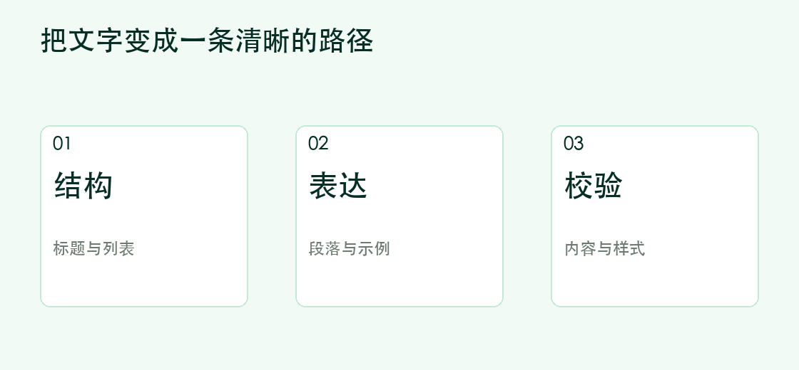

### 引用式图片与无图注图片

![章节标记示意][badge]


上面第二张图片刻意使用++空替代文本++。Markdown 方括号中的内容通常对应图片的替代文本（alt），不等同于独立图注；本项目可以将非空替代文本另行显示为图片说明，但不会替空值编造说明。

### GIF 动图


GIF 同样采用++居中自适应++布局；小图保留自然尺寸，不强制拉伸。

___

## 脚注与安全 HTML：保留补充信息

### 脚注与多行定义

正文里的补充信息可以放入脚注[^scope]。同一个脚注可以再次引用[^scope]，另一个脚注解释++适配原则++[^adapt]。

### 转义与实体

这里保留字面符号：\*不是斜体\*、\_不是斜体\_、\#不是标题、\[不是链接\]、\`不是代码\`、\\反斜杠。标记前的反斜杠用于++防止误解析++。

HTML 实体演示：&amp;、&lt;、&gt;、&copy;、&#9733;。它们解码成可见字符，不显示实体源码。

### 补充阅读：静态展开

<details>
<summary>为什么这里不做折叠交互</summary>

公众号粘贴场景需要++静态内容++。因此折叠组件会展开为补充阅读卡片，标题与正文保留，交互行为不进入干净正文。

- 保留信息，不依赖点击才能看到关键内容。
- 去掉浏览器专用行为，减少平台过滤造成的损失。

</details>

### 未支持的原始 HTML

```html
<!-- 这是代码示例，不是要执行的页面 -->
<article>
  <h2>文章标题</h2>
  <p>原始 HTML 应先经过适配。</p>
</article>
```

例如这里的 <em>强调标签</em>，在本转换器中作为文本安全展示；只对白名单内的行内标签提供主题化转换。这种++安全退化++是本项目策略，不是 Markdown 通用规则。

## 主题扩展组件：写作之外的表现力

::: tip 写作提示
先确定++一个核心问题++，再为每个章节安排一条明确结论。不要先选装饰，再寻找能够塞进去的内容。
:::

::: warning 发布前检查
这份演示使用++本地图片++与示例外链。复制到公众号前，请上传图片并检查地址；尾部的作者与简介也需要替换。
:::

::: info 结构说明
目录精选前三个章节，不代表正文只有三章。全文的二级标题按照顺序++自动编号++，正文不会因为目录精选而删减。
:::

::: quote 一句话记住
排版不是替内容化妆，而是给++读者的理解++留出空间。
:::

::: details 可复用的检查方法
检查标题是否说明问题，段落是否承载一个要点，列表是否属于同一维度，表格是否有清晰的比较对象。这四个问题组成++最小检查清单++。
:::

## 公式与图表：明确扩展的边界

### 数学公式源码

不同 Markdown 工具对公式的支持不同。此处用++源码视窗++保留表达，不加载外部公式脚本。

```latex
行内公式写法：$E = mc^2$

块级公式写法：
$$
S = \sum_{i=1}^{n} x_i
$$
```

### Mermaid 图表源码

以下保留++流程图定义++。它不声称是可交互图表；前面的本地配图已经提供了对应的视觉示意。


公式和 Mermaid 的输入形式已在上面展示；它们在其他环境中可能生成排版或图像，在本项目中仍按源码保留。下面按所属体系继续收录，不把++收录语法++等同于++实现渲染++。

## 核心语法补全：独立写法速查

本章归属：++CommonMark 核心++。前文已有标题、段落、强调、引用、列表、代码、链接、图片、转义和实体，本章补充尚未单独展示的写法，不展开组合测试。

### Setext 一级标题与闭合式 ATX 标题

等号下划线表示一级标题，连字符下划线表示二级标题；ATX 标题也可以在末尾加闭合井号。

```markdown
文章标题
========

章节标题
--------

## 带闭合井号的标题 ##
```

### 软换行

同一段内直接回车属于软换行，与前文的双空格换行、反斜杠换行不同；最终是否显示为视觉换行取决于渲染设置。

```markdown
这是同一段的第一行。
这是同一段的第二行。
```

### 右括号式有序列表

有序列表除句点标记外，还可以使用右括号标记。

```markdown
1) 明确主题。
2) 收集资料。
3) 完成写作。
```

### 带空格的分割线

前文已经展示连续的连字符、星号、下划线；同类标记之间也可以有空格。

```markdown
- - -

* * *

_ _ _
```

### 链接标题的三种定界方式

链接标题可使用双引号、单引号或圆括号。标题不是链接正文，也不等同于图片说明。

```markdown
[阅读材料](https://example.com/reading "阅读材料说明")
[阅读材料](https://example.com/reading '阅读材料说明')
[阅读材料](https://example.com/reading (阅读材料说明))
```

### 相对路径、片段链接与邮件链接

链接目标可以是相对文件路径、片段标识或邮件地址。片段链接使用普通链接语法；标题是否生成对应 ID、ID 如何命名，则由渲染器决定。

```markdown
[本地文档](docs/guide.md)
[指定位置](#custom-id)
[撰写邮件](mailto:editor@example.com)
[带空格的文件](<docs/writing guide.md>)
```

### 图片作为链接与简写引用式图片

图片作为链接用于点击跳转，是一种常用的独立用途写法；引用式图片还可以省略显式资源标签。

```markdown
[](https://example.com/reading)

![章节徽章][]

![章节徽章]

[章节徽章]: assets/markdown-demo/chapter-badge.png "章节徽章标题"
```

### 完整转义字符类别

CommonMark 允许用反斜杠转义 ASCII 标点；下面集中展示可转义的标点集合。

```markdown
\! \" \# \$ \% \& \' \( \) \* \+ \, \- \. \/
\: \; \< \= \> \? \@ \[ \\ \] \^ \_ \` \{ \| \} \~
```

### 字符实体的不同形式

命名实体、十进制数值实体、十六进制数值实体都可以表达字符；不换行空格属于实体用途，不是新的 Markdown 标记。

```markdown
&amp; &lt; &gt; &quot; &copy; &nbsp;
&#9733;
&#x2605;
```

## GFM 与 GitHub：标准扩展和网站功能

本章区分 ++GFM 规范扩展++与 ++GitHub 网站功能++。GFM 扩展包括表格、任务列表、删除线、扩展自动链接和特定原始 HTML 过滤；提示块、提及等网站功能不应全部归入 GFM 语法规范。

### 裸网址与裸邮箱自动链接

归属：GFM 扩展。与前文尖括号包裹的核心自动链接不同，符合规则的裸地址也可以被识别。

```markdown
https://example.com/reading
www.example.com
editor@example.com
```

### 不带首尾竖线的管道表格

归属：GFM 表格扩展。首尾竖线可以省略，表头与分隔行仍需保留。

```markdown
内容 | 状态 | 数量
:--- | :---: | ---:
标题 | 完成 | 6
图片 | 完成 | 2
```

### GitHub 五类提示块

归属：GitHub 网站功能。下面五项分别表达备注、建议、重要信息、警告和风险提醒。

```markdown
> [!NOTE]
> 本文使用本地示例图片。

> [!TIP]
> 发布前检查图片清晰度。

> [!IMPORTANT]
> 请替换作者署名。

> [!WARNING]
> 本地图片不会自动上传。

> [!CAUTION]
> 不要在文章中公开访问令牌。
```

### 用户、团队、议题、提交与表情引用

归属：GitHub 网站功能。解析与通知行为受所在页面、仓库、权限和上下文限制；这些例子只展示格式，不代表真实账号或提交。

```markdown
@username
@organization/team-name
#123
owner/repository#123
0123456789abcdef0123456789abcdef01234567
:smile:
:+1:
```

### 自定义 HTML 锚点

归属：GitHub 等允许相应 HTML 的环境。这不是花括号标题属性写法，最终是否保留由平台的 HTML 策略决定。

```html
<a name="writing-checklist"></a>
```

```markdown
[跳到检查清单](#writing-checklist)
```

### GFM 原始 HTML 过滤

归属：GFM 安全规则，不是一种可视组件。GFM 的 tagfilter 涉及 `title`、`textarea`、`style`、`xmp`、`iframe`、`noembed`、`noframes`、`script`、`plaintext`；GitHub 网站还会进一步清理输出，不能由“支持 HTML”推断任意标签都能执行。

## 文本扩展：术语、标记与编辑批注

### 定义列表

归属：Pandoc、PHP Markdown Extra 等扩展体系。用于术语及其解释，不是 CommonMark 核心。

```markdown
Markdown
: 一种轻量级标记语言。

排版
: 为内容建立视觉层级的过程。
```

### 缩写定义

归属：PHP Markdown Extra、Python-Markdown 的 Abbreviations 扩展等。正文中的缩写可以关联完整名称。

```markdown
HTML 用于组织网页内容。

*[HTML]: HyperText Markup Language
```

### 上标与下标

归属：Pandoc 的 superscript、subscript 扩展等。其他插件也可能采用相同外形，仍需确认配置。

```markdown
面积为 12 m^2^。
水的化学式是 H~2~O。
```

### 高亮、插入文本与下划线

归属：对应的 markdown-it 插件或其他兼容实现。相同符号在不同体系中可能含义不同。

```markdown
==需要注意的内容==
++新增的文字++
```

`==文字==` 可由 markdown-it-mark 解释为高亮；`++文字++` 可由 markdown-it-ins 解释为插入文本。本项目则将 `++文字++` 定义为主题关键词下划线，++两种语义不能混为一谈++。HTML 的 `<u>` 是另一条实现途径，不存在各平台通用的独立 Markdown 下划线标记。

### 剧透文本

归属：Discord 消息格式等平台。双竖线包裹的内容可被隐藏，需要点击查看；这不是通用 GFM 语法。

```markdown
||这里是需要读者主动展开的剧情信息。||
```

### 智能标点

归属：Pandoc smart 等排版扩展。这是字符转换规则，不是新的块级元素。

```text
"quoted text"
'quoted text'
first -- second
first --- second
wait...
```

支持的环境可将直引号、连字符组合和省略号转换为排版字符；代码内容通常不应采用此类转换。

### CriticMarkup 编辑批注

归属：CriticMarkup 及兼容插件，用于记录修改建议。

```text
这是{++新增++}的内容。
这是{--删除--}的内容。
将{~~旧说法~>新说法~~}进行替换。
这里{==需要重点检查==}。
{>>请核实这项数据的来源。<<}
```

### 行块

归属：Pandoc line_blocks 扩展。适合诗歌、地址或需要保留逐行结构的短文。

```markdown
| 写作先于装饰，
| 结构先于颜色，
| 清晰先于热闹。
```

## 元数据、属性与通用容器

### YAML Front Matter

归属：Jekyll、VitePress、Pandoc 等支持元数据的环境。通常置于独立文档开头；放在本文代码块内只是展示。

```yaml
---
title: Markdown 语法全景
author: 示例作者
date: 2026-11-23
tags:
  - Markdown
  - 写作
draft: true
---
```

### TOML 与 JSON Front Matter

归属：Hugo 等站点生成器。TOML 常用 `+++` 包围；Hugo 的 JSON 元数据使用开头的 JSON 对象，不套用 YAML 分隔符。

```toml
+++
title = "Markdown 语法全景"
draft = true
tags = ["Markdown", "写作"]
+++
```

```json
{
  "title": "Markdown 语法全景",
  "draft": true,
  "tags": ["Markdown", "写作"]
}
```

### Pandoc 标题元数据

归属：Pandoc pandoc_title_block 扩展。百分号形式依次描述标题、作者和日期。

```markdown
% Markdown 语法全景
% 示例作者
% 2026-11-23
```

### 标题 ID、类名与键值属性

归属：Pandoc 标题属性等；VitePress 也支持自定义标题锚点，但不等于支持这里的全部属性。

```markdown
### 写作检查 {#writing-checklist .unnumbered}

### 补充资料 {-}
```

其中 `#writing-checklist` 表示 ID，`.unnumbered` 表示类，Pandoc 中 `{-}` 是不编号标题的简写。

### 链接与图片属性

归属：Pandoc link_attributes 等扩展。属性是否作用于输出还取决于目标格式。

```markdown
[阅读材料](https://example.com/reading){#reading-link .external}

{#fig-flow width=60%}
```

### 行内 Span

归属：Pandoc bracketed_spans 扩展。把一段文字作为可附加属性的行内容器。

```markdown
[需要特别说明的文字]{.notice lang=zh-CN}
```

### 块级 Div

归属：Pandoc fenced_divs 扩展。冒号围栏配合属性形成块级容器。

```markdown
::: {.notice #writing-note}
这是写作说明区。
:::
```

它与本项目 `::: tip` 的外观相似，但属性语法、类型和语义不相同。

### kramdown 行内与块级属性列表

归属：kramdown 的 Inline Attribute Lists。注意其 `{: ...}` 前缀与 Pandoc 属性写法不同。

```markdown
这是一个说明段落。
{: .notice #notice}

一段 *强调文字*{: .special}
```

### 代码块属性与行号

归属：Pandoc fenced_code_attributes。语言、ID、类与起始行号通过属性指定；实际行号展示取决于输出方式。

````markdown
```{#sample .python .numberLines startFrom="5"}
print("检查文章结构")
```
````

## 表格与图注扩展

本章归属：主要为 ++Pandoc 表格扩展++。前文的管道表格只是表格写法之一，以下写法不是所有编辑器都能识别。

### 简单表格

```markdown
内容类型    状态     数量
----------  ------  ----
标题        完成       6
图片        完成       2
```

### 多行表格

```markdown
-----------------------------------
内容类型          说明
----------------  -----------------
写作流程          包含结构、
                  表达与校验

发布检查          包含图片、
                  链接与署名
-----------------------------------
```

### 网格表格

```markdown
+--------------+------------------+
| 内容类型     | 说明             |
+==============+==================+
| 写作流程     | 结构与表达       |
+--------------+------------------+
| 发布检查     | 图片与署名       |
+--------------+------------------+
```

### 无表头管道表格

归属：Pandoc 的相应管道表格扩展能力；不能套用为 GFM 表格规则。

```markdown
|---------|---------|
| 结构    | 清楚    |
| 表达    | 准确    |
```

### 表格标题

归属：Pandoc table_captions。表格说明独立于单元格。

```markdown
| 项目 | 数量 |
| --- | ---: |
| 标题 | 6 |

: 发布检查统计
```

### 隐式图片图注

归属：Pandoc implicit_figures。单独成段且具有非空替代文本的图片可形成带说明的图；这不是所有 Markdown 实现共享的行为。

```markdown

```

## 脚注、文献与原始格式

### 行内脚注

归属：Pandoc inline_notes。前文已展示引用式脚注，本项把脚注内容直接写在正文处。

```markdown
先确认文章结构。^[这里的结构指标题与段落之间的信息关系。]
```

### 文献引用

归属：Pandoc citations 配合 citeproc 等工具。引用键需要匹配参考文献数据，不会凭空生成文献。

```markdown
括号式引用：[@writing2026]

叙述式引用：@writing2026 讨论了信息结构。

多文献引用：[@writing2026; @layout2025]

带定位信息：[@writing2026, pp. 12-15]

省略作者：[-@writing2026]
```

### 参考文献数据与输出位置

归属：Pandoc 元数据及引用处理。下面是独立文档的元数据和参考文献占位容器，实际输出还需启用引用处理。

```markdown
---
bibliography: references.bib
csl: style.csl
link-citations: true
---

正文引用：[@writing2026]。

::: {#refs}
:::
```

### 原始格式块与行内原始格式

归属：Pandoc raw_attribute。花括号内的 `=格式` 指明原始输出格式，不等同于语法高亮语言名。

````markdown
```{=latex}
\newpage
```

分页命令：`\newpage`{=latex}
````

### 原始 TeX 命令

归属：Pandoc raw_tex 等支持环境。普通 Markdown 不会因此自动执行 LaTeX。

```latex
\newpage
\LaTeX
```

## 数学公式：输入定界与表达类别

本章是数学扩展的++输入速查++。公式内部使用 TeX 风格语言；分式、矩阵等不是各自独立的 Markdown 语法。

### 美元符号定界

归属：Pandoc tex_math_dollars、MathJax／KaTeX 集成的相应配置等。具体空白与定界识别规则依实现而定。

```text
行内：$E = mc^2$

块级：
$$
S = \sum_{i=1}^{n} x_i
$$
```

### 反斜杠定界

归属：支持对应数学定界配置的环境，例如 Pandoc 的相应 tex_math 扩展或 MathJax 配置。必须在 Markdown 处理阶段保留这些定界符。

```text
行内：\(E = mc^2\)

块级：
\[
E = mc^2
\]
```

### 数学代码围栏

归属：GitHub 等支持 `math` 围栏的环境。其他环境可能仅把它当作代码块。

````markdown
```math
E = mc^2
```
````

### 常见公式表达

归属：TeX 数学语言及所用公式引擎。下面覆盖常见表达类别，不将它们误记为 Markdown 插件种类。

```latex
上下标：x_i^2
分式：\frac{a}{b}
根式：\sqrt{x}
求和：\sum_{i=1}^{n} x_i
积分：\int_a^b f(x)\,dx
极限：\lim_{x \to 0} \frac{\sin x}{x}
希腊字母：\alpha + \beta = \gamma
关系符号：a \leq b,\quad x \in A
向量：\vec{v}
矩阵：\begin{bmatrix} a & b \\ c & d \end{bmatrix}
分段：f(x)=\begin{cases}x,&x\geq0\\-x,&x<0\end{cases}
对齐：\begin{aligned}a&=b+c\\d&=e+f\end{aligned}
```

## 图表、地图与三维模型

图表扩展通常复用++带语言名的代码围栏++。图表语言的内部命令不是 Markdown 核心语法；以下收录入口和代表性写法，不承诺本项目生成图像，也不试图穷尽各图表语言的全部命令。

### Mermaid 图表类别

归属：Mermaid 集成。前文已展示流程图，这里补充常用序列、类、状态、实体关系、甘特、饼图、思维导图和时间线写法；实际支持随 Mermaid 版本及宿主变化。

````markdown
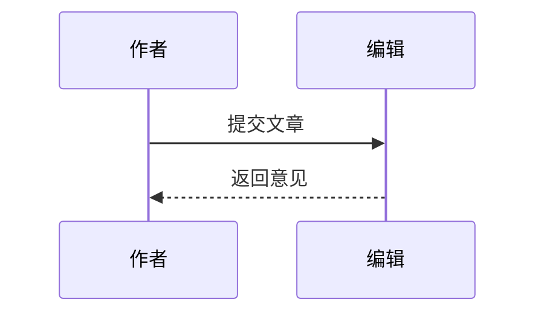

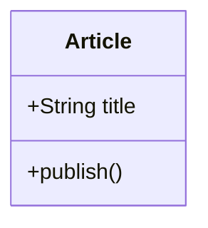

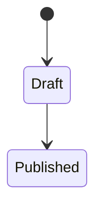

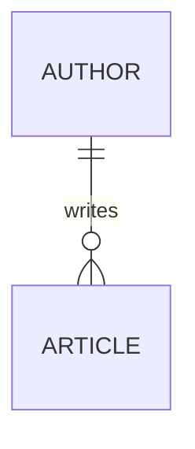

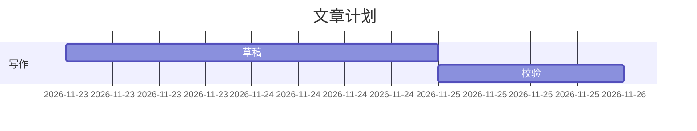

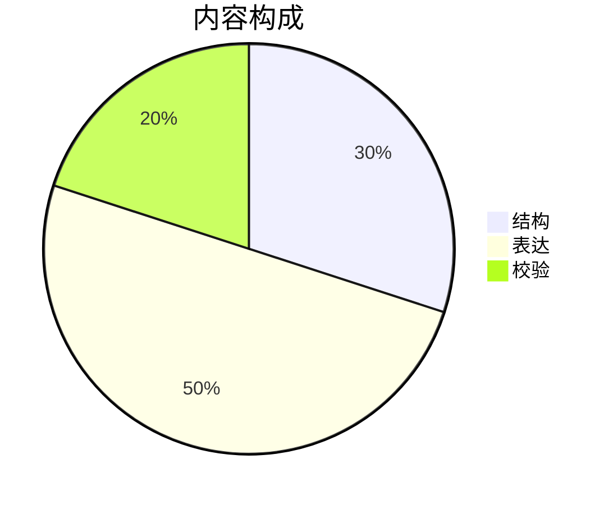

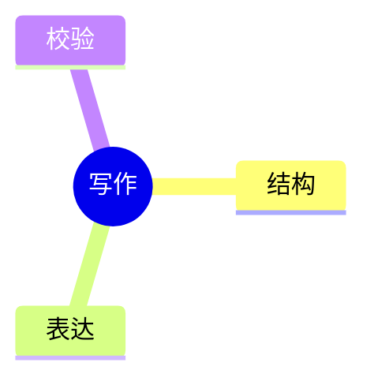

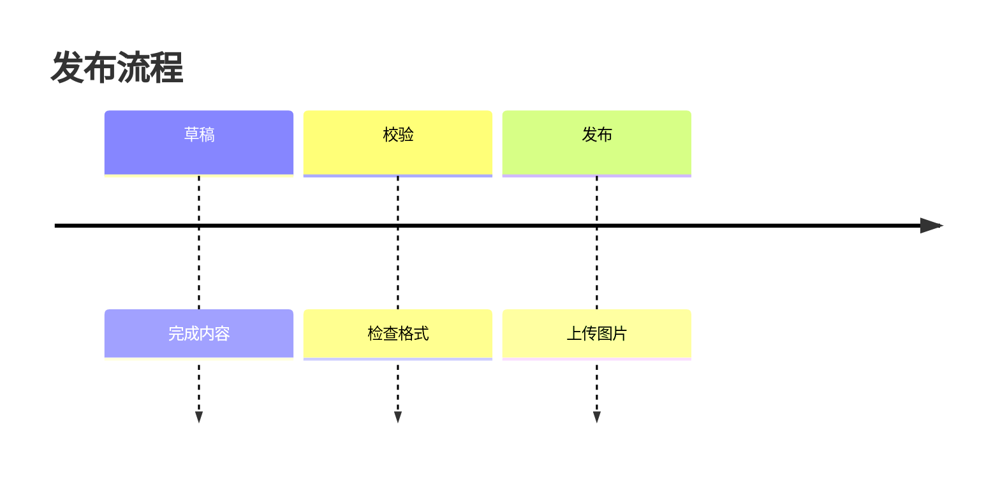
````

### PlantUML

归属：配置 PlantUML 渲染插件的环境。`plantuml` 并非所有平台内置的围栏语言处理器。

````markdown
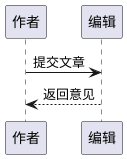
````

### Graphviz DOT

归属：配置 Graphviz 或相应插件的环境。

````markdown
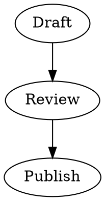
````

### Vega-Lite 数据图表

归属：支持 Vega-Lite 围栏的插件或宿主。

````markdown
```vega-lite
{
  "$schema": "https://vega.github.io/schema/vega-lite/v5.json",
  "data": {"values": [{"stage": "结构", "value": 3}, {"stage": "表达", "value": 5}]},
  "mark": "bar",
  "encoding": {
    "x": {"field": "stage", "type": "nominal"},
    "y": {"field": "value", "type": "quantitative"}
  }
}
```
````

### GeoJSON 与 TopoJSON 地图

归属：GitHub 的图表显示功能等。地图数据是 JSON，围栏语言名决定宿主是否尝试渲染。

````markdown
```geojson
{
  "type": "FeatureCollection",
  "features": [{
    "type": "Feature",
    "properties": {"name": "示例地点"},
    "geometry": {"type": "Point", "coordinates": [121.47, 31.23]}
  }]
}
```

```topojson
{
  "type": "Topology",
  "objects": {
    "place": {"type": "Point", "coordinates": [121.47, 31.23]}
  },
  "arcs": []
}
```
````

### ASCII STL 三维模型

归属：GitHub 等支持 STL 可视化的环境。下面仅用一个三角面展示文本结构，不代表闭合实体。

````markdown
```stl
solid sample
  facet normal 0 0 1
    outer loop
      vertex 0 0 0
      vertex 1 0 0
      vertex 0 1 0
    endloop
  endfacet
endsolid sample
```
````

## 笔记扩展：双链、嵌入、标签与批注

本章主要归属：++Obsidian++。相似写法也可能出现在其他工具中，但不是各笔记软件通用的协议。

### Wiki 双链与显示别名

```markdown
[[写作方法]]
[[写作方法|阅读写作方法]]
[[写作方法#检查清单]]
```

### 块 ID 与块引用

块 ID 标记一个可引用的内容块，`#^` 用于指向该块。

```markdown
先确认文章要解决的问题。 ^writing-principle

[[写作方法#^writing-principle]]
```

### 笔记、标题与块嵌入

在 Wiki 链接前加感叹号，可以请求宿主嵌入对应内容。

```markdown
![[写作方法]]
![[写作方法#检查清单]]
![[写作方法#^writing-principle]]
```

### 附件、图片尺寸与 PDF 页码

```markdown
![[writing-flow.png]]
![[writing-flow.png|320]]
![[writing-flow.png|320x180]]
![[writing-guide.pdf#page=3]]
![[writing-audio.mp3]]
![[writing-video.mp4]]
```

这些附件名仅用于展示语法，不表示本文目录中提供了相应文件。

### 标签

```markdown
#写作
#写作/Markdown
```

行内井号标签属于笔记索引约定；它与后面带空格的 ATX 标题不同。

### 隐藏批注

```markdown
正文可见。%%这里是编辑批注，阅读视图隐藏。%%

%%
这是一段多行编辑批注。
%%
```

### Callout 与可折叠 Callout

```markdown
> [!info] 阅读提示
> 先阅读文章结构。

> [!tip]- 默认折叠
> 这里是补充建议。

> [!warning]+ 默认展开
> 发布前替换示例地址。
```

`-`、`+` 用于控制支持环境的初始展开状态。不要把它们与 GitHub 提示块的支持范围混同。

## 文档站扩展：目录、提示、标签页与引用文件

### 自动目录占位

归属：各自的编辑器或插件；占位符不能跨平台互换。

```markdown
[TOC]
```

上例常见于 Typora 等支持环境；Python-Markdown 的 TOC 扩展也采用 `[TOC]`。

VitePress 的目录写法为：

```markdown
[[toc]]
```

### MkDocs 提示与折叠块

归属：Python-Markdown Admonition、PyMdown Details 等扩展；需要相应配置。下列缩进是各组件本身要求的正文语法，不是额外的嵌套测试。

```markdown
!!! note "阅读提示"
    先确定文章结构。

??? tip "默认折叠"
    这里是补充建议。

???+ warning "默认展开"
    发布前检查所有图片。
```

### MkDocs 内容标签页

归属：PyMdown Tabbed，例如 Material for MkDocs 的配置环境。

```markdown
=== "写作"
    先完成内容。

=== "排版"
    再建立视觉层级。
```

### VitePress 自定义容器

归属：VitePress。它和本项目都可能采用冒号围栏，但支持类型与输出行为由各自实现决定。

```markdown
::: info
这是说明。
:::

::: tip 建议
先整理文章结构。
:::

::: warning
检查本地图片。
:::

::: danger
不要公开访问令牌。
:::

::: details 补充阅读
这里是可展开内容。
:::
```

### VitePress 代码行高亮与行号

归属：VitePress 代码扩展，不能与 Pandoc 的代码属性语法互换。

````markdown
```js{2}
const title = "文章";
const ready = true;
```

```js:line-numbers
const title = "文章";
```

```js
const oldTitle = "旧标题"; // [!code --]
const newTitle = "新标题"; // [!code ++]
const focused = true; // [!code focus]
```
````

### VitePress 代码组与代码文件引用

归属：VitePress。引用文件需要实际存在，路径相对于相应构建配置和文档位置解析。

````markdown
::: code-group
```sh [npm]
npm install
```

```sh [pnpm]
pnpm install
```
:::

<<< ./snippets/example.js
````

### MyST 角色与指令

归属：MyST，通常用于 Sphinx 等文档环境。角色为行内结构，指令为块级结构，通常需要相应构建工具。

````markdown
{ref}`writing-checklist`

```{note}
先检查文章结构。
```

```{include} writing-notes.md
```
````

## HTML 补充：注释、语义标签与媒体

本章归属：++原始 HTML++，不是额外的 Markdown 核心标记。是否保留、是否交互以及是否加载媒体由宿主安全策略决定，本项目也不会因为本章收录而放开 HTML 白名单。

### HTML 注释

```html
<!-- 给作者看的注释，不作为可见正文展示。 -->
```

### 行内语义标签

```html
<em>强调</em>
<strong>重要内容</strong>
<u>下划线</u>
<ins>新增内容</ins>
<del>删除内容</del>
<s>不再准确的说法</s>
<mark>标记</mark>
<sub>下标</sub>
<sup>上标</sup>
<kbd>Ctrl</kbd>
<abbr title="HyperText Markup Language">HTML</abbr>
<small>补充说明</small>
<ruby>汉<rt>hàn</rt></ruby>
```

### 块级结构与图片图注

```html
<section>
  <p>这是一个段落。</p>
</section>

<figure>
  
  <figcaption>写作流程示意</figcaption>
</figure>
```

### 合并单元格

普通管道表格没有通用的单元格合并标记；允许 HTML 的环境可采用 HTML 表格。

```html
<table>
  <tr><th colspan="2">检查项目</th></tr>
  <tr><td rowspan="2">发布</td><td>图片</td></tr>
  <tr><td>署名</td></tr>
</table>
```

### 音频、视频与嵌入页面

这些是 HTML 媒体入口，不是 `![图片]` 的通用音视频变体；宿主可能禁止。

```html
<audio controls src="writing-audio.mp3"></audio>
<video controls src="writing-video.mp4"></video>
<iframe src="https://example.com/embedded" title="示例页面"></iframe>
```

## 组件、模板与可执行文档

本章收录 ++Markdown 周边扩展入口++。模板处理、组件运行和代码执行需要各自工具链，不能由普通 Markdown 解析器自动完成；本文仅展示，不执行任何示例。

### MDX 的 JSX 组件

归属：MDX。组件需要导入、定义或由运行环境提供。

```mdx
import ReadingCard from './ReadingCard.jsx'

export const title = '写作方法'

# 写作方法

<ReadingCard title="先确定读者问题" />
```

### MDX 表达式与注释

归属：MDX。花括号表达式、JSX 和注释规则不同于普通 HTML；不能把普通 Markdown 的所有行为直接套用到 MDX。

```mdx
检查项数量：{2 + 3}

{/* 这是 MDX 注释。 */}
```

### Vue 组件与插值

归属：VitePress 等集成 Vue 的文档站。

```markdown
<script setup>
const title = '写作方法'
</script>

# {{ title }}
```

### Jekyll Liquid 模板

归属：Jekyll 的模板处理，不是 Markdown 语法。

```liquid
{{ page.title }}


```

### Hugo Shortcode

归属：Hugo 的短代码机制。短代码必须由内置功能或项目模板提供；下面的 `notice` 是自定义名称示例。

```text

请检查文章署名。

```

### Quarto／R Markdown 可执行代码块

归属：相应可执行文档工具链。`{python}` 或 `{r}` 具有执行含义，不同于单纯的 `python`、`r` 高亮围栏。

````markdown
```{python}
#| echo: true
print("文章检查")
```

```{r}
summary(c(1, 2, 3))
```
````

### Quarto 交叉引用

归属：Quarto。图、表、公式等对象的标签和引用需要其交叉引用系统处理。

```markdown
{#fig-writing}

参见 @fig-writing。
```

### 幻灯片分隔与备注

归属：Marp 等幻灯片工具。下面以 Marp 为例，水平分割线会被解释为分页，而不只是正文分割线。

```markdown
---
marp: true
---

# 第一页：明确主题

---

# 第二页：组织内容

<!-- 这是演讲者备注。 -->
```

## 本项目语法：主题组件入口

本章只描述++本项目约定++。前文已经提供真实组件，本章集中列出可复制的写法；不要据此推断其他编辑器具有相同组件。

### 行内标记

```markdown
++主题关键词下划线++
==主题高亮==
<u>主题下划线</u>
```

### 说明、提示与警告

```markdown
::: info 结构说明
这里是说明正文。
:::

::: tip 写作提示
这里是建议正文。
:::

::: warning 发布检查
这里是警告正文。
:::
```

### 金句与补充阅读

```markdown
::: quote 一句话记住
先让内容清楚，再让版式漂亮。
:::

::: details 补充阅读
这里的内容适配为静态补充阅读卡片。
:::
```

### 作者介绍与互动

```markdown
::: author
{{简介}}
:::

::: engagement
欢迎点赞、在看、转发。
:::
```

这里的 `{{简介}}` 是本项目的作者自填占位约定，不是通用变量求值语法；也不等于前文 Liquid、Vue 的模板机制。

## 语法归属索引与参考资料

### 核心与扩展归属总览

| 体系 | 本文收录的语法类别 | 使用前提 |
| --- | --- | --- |
| CommonMark | 标题、段落、软硬换行、强调、引用、列表、代码、分割线、链接、图片、转义、实体、原始 HTML | 兼容解析器；HTML 仍受宿主限制 |
| GFM | 管道表格、删除线、任务列表、裸地址自动链接、特定 HTML 过滤 | GFM 兼容解析器 |
| GitHub 网站 | 提示块、提及、议题与提交引用、表情、数学、地图与模型等 | 网站功能及所在页面支持 |
| Pandoc | 元数据、定义列表、行块、属性、Span、Div、多类表格、图注、脚注、文献、数学、原始格式等 | 对应扩展与输出格式 |
| Markdown Extra／Python-Markdown | 定义列表、缩写、脚注、属性、目录等相应扩展 | 实现及扩展配置 |
| kramdown | 行内及块级属性列表 | kramdown |
| markdown-it 插件 | 高亮、插入文本等 | 指定插件 |
| CriticMarkup | 新增、删除、替换、高亮、批注 | 兼容处理器 |
| Obsidian | 双链、块引用、嵌入、标签、批注、Callout | 对应笔记环境 |
| Discord | 剧透文本 | 对应消息环境 |
| MkDocs／PyMdown | 提示、折叠、内容标签页等 | 对应扩展配置 |
| VitePress | 目录、容器、代码增强、代码组、文件引用、Vue | 对应站点构建环境 |
| MyST | 角色、指令、文件包含等 | MyST 及相关构建工具 |
| MDX | JSX、表达式、ESM、MDX 注释 | MDX 编译运行环境 |
| Jekyll／Hugo | 元数据、模板、短代码 | 各自模板处理环境 |
| Quarto／R Markdown | 可执行代码块、交叉引用等 | 各自文档工具链 |
| Marp | 幻灯片元数据、分页、演讲者备注 | Marp |
| 图表插件 | Mermaid、PlantUML、DOT、Vega-Lite 等入口 | 对应渲染器 |
| 本项目 | 关键词下划线、主题高亮、提示卡、金句、补充阅读、作者与互动 | 本项目转换器 |

### 官方规范与扩展文档

以下资料用于核对语法归属。CommonMark 按 0.31.2、GFM 按 0.29-gfm 规范入口列出；其他文档以访问时的内容与实际安装版本为准。本文不将这些版本称为永远最新，也不将尚未逐项验证的扩展示例当作本转换器的支持承诺。

- [CommonMark 规范](https://spec.commonmark.org/0.31.2/)
- [GFM 规范](https://github.github.io/gfm/)
- [GitHub 写作与格式](https://docs.github.com/en/get-started/writing-on-github)
- [Pandoc 用户指南](https://pandoc.org/MANUAL.html)
- [PHP Markdown Extra](https://michelf.ca/projects/php-markdown/extra/)
- [Python-Markdown 扩展](https://python-markdown.github.io/extensions/)
- [kramdown 语法](https://kramdown.gettalong.org/syntax.html)
- [markdown-it 插件组织](https://github.com/markdown-it)
- [CriticMarkup 语法](https://github.com/CriticMarkup/CriticMarkup-toolkit/blob/master/README.md)
- [Obsidian 帮助](https://help.obsidian.md/)
- [Discord 消息格式](https://support.discord.com/hc/en-us/articles/210298617)
- [Material for MkDocs 参考文档](https://squidfunk.github.io/mkdocs-material/reference/)
- [VitePress Markdown 扩展](https://vitepress.dev/guide/markdown)
- [MyST 语法](https://myst-parser.readthedocs.io/en/latest/syntax/typography.html)
- [MDX 文档](https://mdxjs.com/docs/what-is-mdx/)
- [Jekyll Liquid](https://jekyllrb.com/docs/liquid/)
- [Hugo 内容格式](https://gohugo.io/content-management/formats/)
- [Quarto Markdown 基础](https://quarto.org/docs/authoring/markdown-basics.html)
- [R Markdown 文档](https://rmarkdown.rstudio.com/lesson-3.html)
- [Marp Markdown](https://marpit.marp.app/markdown)
- [Mermaid 图表语法](https://mermaid.js.org/intro/syntax-reference.html)
- [PlantUML](https://plantuml.com/)
- [Graphviz DOT](https://graphviz.org/doc/info/lang.html)
- [Vega-Lite](https://vega.github.io/vega-lite/docs/)

## 总结：把语法变成一条工作流

一篇可读文章的工作流可以归纳为++结构、表达、校验++。标题与列表解决结构，段落与代码解决表达，预览与检查解决交付。

- ++基础层++：标题、段落、换行、强调、引用、列表、代码、链接、图片、分割线。
- ++扩展层++：表格、任务列表、删除线、脚注、定义列表、缩写、上下标、属性、容器、元数据、文献、数学与图表等。
- ++平台层++：GitHub 网站功能、笔记双链与嵌入、文档站提示与标签页、组件、模板、可执行文档与幻灯片等，均标明所属体系。
- ++主题层++：本项目的关键词下划线、高亮、提示卡、金句卡、补充阅读、署名与互动。
- ++边界层++：收录一种语法不等于本项目已经实现它；各方言扩展按源码展示，不额外引入嵌套测试，也不承诺穷尽任意插件。

::: author
{{简介}}
:::

::: engagement
如果你觉得今天这篇有收获，欢迎点赞、在看、转发三连，我们下篇见。
:::

[^scope]: 本文是可修改的语法演示，不代表所有 Markdown 实现拥有相同功能。
[^adapt]: 公众号适配优先保留内容与内联样式。
    外链静态展示、折叠卡展开、复杂图表保留源码。

[reading]: https://example.com/reading "示例阅读"
[示例索引]: https://example.com/index
[badge]: assets/markdown-demo/chapter-badge.png
