<div align="center">

# gzh-article-layout

**Turn your finished article into WeChat-ready content you can preview, copy, and validate**

15 theme palettes × 3 chapter layouts · Markdown / DOCX / PDF / plain text · Offline HTML rendering

[Quick Start](#quick-start) · [Theme Previews](#theme-previews) · [Workflow](#workflow) · [Limitations](#limitations)

[English](README.en.md) ｜ [中文](README.md)

</div>

---

`gzh-article-layout` is a WeChat article layout Skill for AI agents. Provide Markdown or an article file, and the Skill organizes the content, applies theme components, and produces HTML for the WeChat editor, along with a browser preview and copy action.

It formats existing content rather than writing articles. The default theme is **墨规 · 翡翠林木** (`emerald + ruler`); this combination is applied directly when no theme or layout is specified.

## Features

- **15 built-in themes** across green, blue, red, purple, monochrome, and warm palettes.
- **3 chapter layouts**: 墨规 `ruler`, 浮光 `overprint`, and 素墨 `pure`. Each palette can be combined with any layout.
- **Article components** for headings, intros, chapters, quotes, lists, tables, code, images, GIFs, footnotes, and supplementary reading blocks.
- **WeChat-oriented HTML output** with inline styles and compatibility checks.
- **Preview and copy** with a browser page that lets you inspect and copy the formatted content.
- **Multiple input formats**: Markdown is handled directly; DOCX, PDF, TXT, and webpage text are first normalized to Markdown.
- **Custom themes** can be created from a style description or reference image. See the [theme generation guide](references/theme-generator.md).

## Theme Previews

These 15 phone-sized screenshots were rendered from the same sample article using this project. Each theme uses its registered default chapter layout. Images show only the article content, without the browser preview toolbar; click an image to view it at full size.

<table>
<tr>
<td align="center"><a href="docs/images/theme-emerald.png">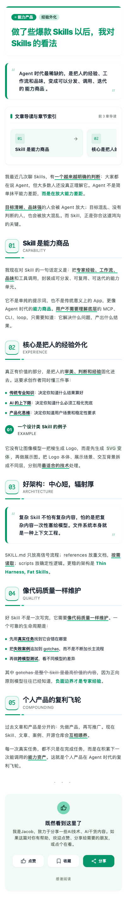</a><br>墨规 · 翡翠林木</td>
<td align="center"><a href="docs/images/theme-bamboo-teal.png">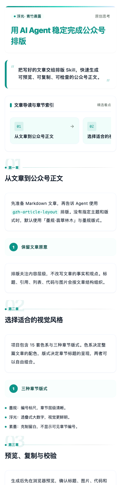</a><br>浮光 · 青竹晨露</td>
<td align="center"><a href="docs/images/theme-pine-green.png">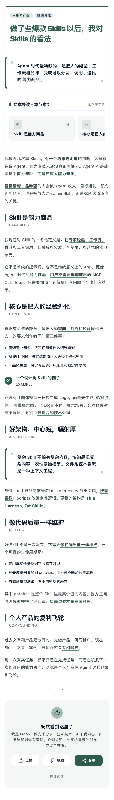</a><br>佩兰 · 寒松冷柏</td>
</tr>
<tr>
<td align="center"><a href="docs/images/theme-mineral-blue.png">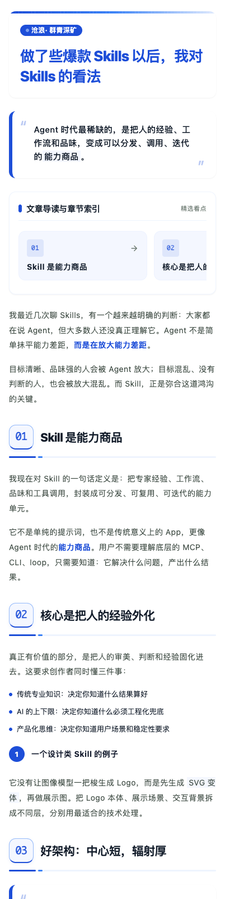</a><br>沧浪 · 群青深矿</td>
<td align="center"><a href="docs/images/theme-cerulean.png">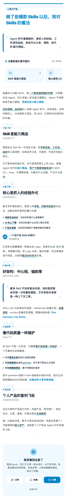</a><br>霁蓝 · 雨过天晴</td>
<td align="center"><a href="docs/images/theme-abyssal-indigo.png">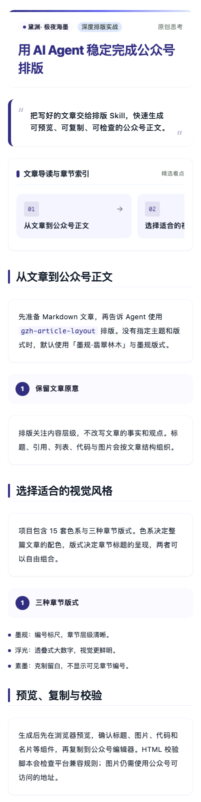</a><br>黛渊 · 极夜海墨</td>
</tr>
<tr>
<td align="center"><a href="docs/images/theme-vermilion-seal.png">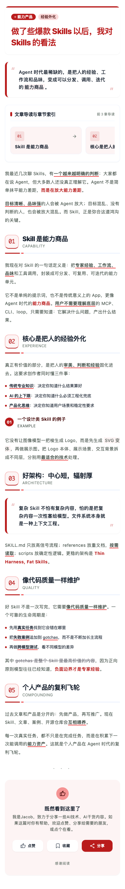</a><br>朱印 · 藏书官印</td>
<td align="center"><a href="docs/images/theme-terracotta.png">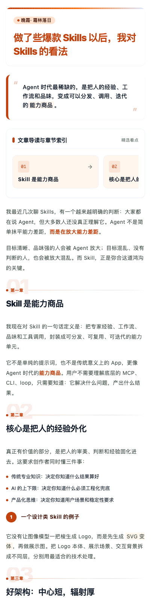</a><br>晚霞 · 霜林落日</td>
<td align="center"><a href="docs/images/theme-burgundy.png">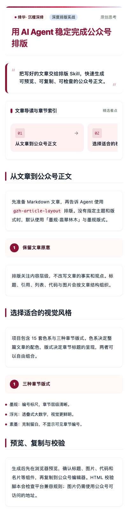</a><br>绛华 · 沉檀深绛</td>
</tr>
<tr>
<td align="center"><a href="docs/images/theme-amber-honey.png">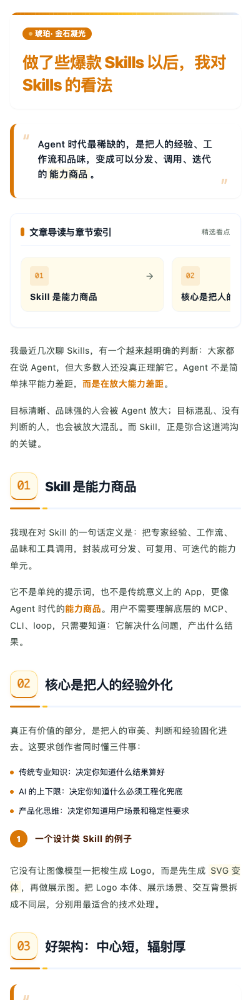</a><br>琥珀 · 金石凝光</td>
<td align="center"><a href="docs/images/theme-sandalwood.png">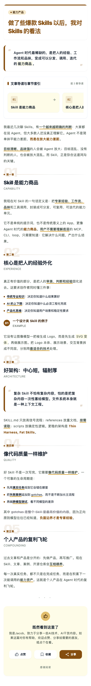</a><br>古檀 · 沉香木案</td>
<td align="center"><a href="docs/images/theme-moss-clay.png">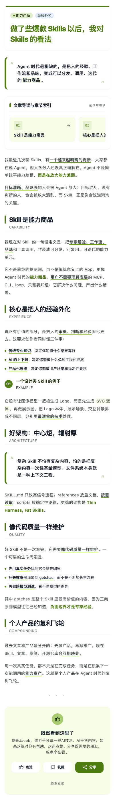</a><br>苍苔 · 阶前青痕</td>
</tr>
<tr>
<td align="center"><a href="docs/images/theme-imperial-violet.png">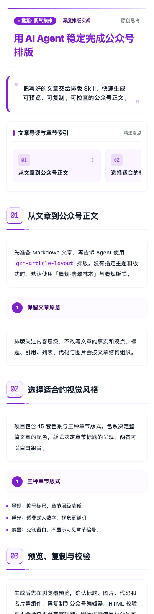</a><br>黛紫 · 紫气东来</td>
<td align="center"><a href="docs/images/theme-monochrome-zen.png">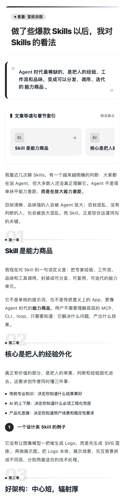</a><br>素墨 · 宣纸淡烟</td>
<td align="center"><a href="docs/images/theme-frost-slate.png">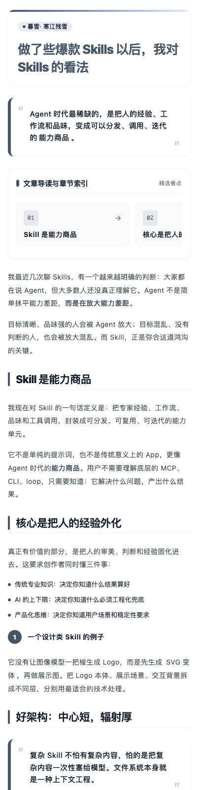</a><br>暮雪 · 寒江残雪</td>
</tr>
</table>

Explore all 45 theme and layout combinations in the [theme gallery](docs/gallery/index.html), or see the [theme catalog](references/theme-index.md) and [all preview links](docs/all-themes.md).

## Use Cases

**Suitable for** finished tutorials, opinion pieces, product roundups, interviews, data reports, case studies, and personal essays that need WeChat-ready formatting.

**Not intended for** writing articles, generic websites or landing pages, slide decks, image posters, or logging into WeChat to upload assets, create drafts, or publish content.

## Quick Start

### Use with an AI Agent

Have an agent that can read local Skill files load this project's [SKILL.md](SKILL.md), then provide an article or file path:

```text
Use gzh-article-layout to format article.md for a WeChat article.
Generate a browser preview I can copy from, and validate the output.
```

The default is **墨规 · 翡翠林木** (`emerald + ruler`). You can also specify a theme, layout, and author details:

```text
Format article.md for WeChat.
Theme: bamboo-teal; layout: overprint
Author: Jacob
Bio: Writing about product and engineering
```

If only a theme is specified, its registered default layout is used. If only a layout is specified, it is combined with the default `emerald` palette. The agent recommends themes by topic only when explicitly asked.

For DOCX, PDF, TXT, or webpage text, the agent first normalizes the content to Markdown. By default, it confirms the resulting structure; say “format it directly” to skip that confirmation.

### Run the Offline Renderer

The Markdown renderer uses the Python 3 standard library and needs no third-party Python packages. Run from the project root:

```bash
python3 scripts/render_stitch_article.py article.md \
  --output /tmp/article.html
python3 scripts/validate_gzh_html.py /tmp/article.html
python3 scripts/wrap_preview.py /tmp/article.html
```

Open `/tmp/article_预览.html`, review the result, then click **Copy to WeChat**. If theme and layout are omitted, the renderer uses `emerald + ruler`.

| Option | Description |
|---|---|
| `--theme` | Theme ID; defaults to `emerald` |
| `--layout` | `ruler`, `overprint`, or `pure` |
| `--author` / `--bio` | Author name and bio |
| `--qr-url` | URL of a real QR-code image; no QR code is used when omitted |
| `--list-themes` | List built-in themes |

DOCX can be extracted to Markdown first:

```bash
python3 scripts/extract_docx.py article.docx -o article.md
```

## Workflow

1. Provide an article or file; normalize non-Markdown input to Markdown first.
2. Choose a theme and layout, or use the default `emerald + ruler`.
3. Assemble theme components according to the article structure and generate HTML plus a browser preview.
4. Validate the HTML, inspect the preview, and copy the content into the WeChat editor.

Common Markdown markers include `**bold**`, `==highlight==`, `++underlined keyword++`, `~~strikethrough~~`, and the `::: warning`, `::: info`, `::: tip`, and `::: quote` blocks. When running the converter directly, prepare semantic markings in the Markdown yourself; the Agent workflow can identify keywords from the article.

## Documentation

- [Skill workflow](SKILL.md)
- [Product guide](docs/product-guide.md)
- [Theme catalog](references/theme-index.md)
- [Input normalization rules](references/format-normalize.md)
- [Custom theme generation guide](references/theme-generator.md)
- [Design provenance and WeChat compatibility notes](references/stitch-design-system.md)

## Limitations

- This project formats articles. It does not write content, upload images, or connect to or operate a WeChat account.
- Images and QR codes must be hosted at addresses accessible to the target environment. Local images are not uploaded automatically.
- Output is checked against this project's compatibility rules, but rendering can vary across WeChat editors, clients, and dark mode. Test by pasting into the target editor before publishing.
- The offline renderer accepts Markdown. PDF, TXT, and webpage text are normalized through the Agent workflow.

## License

See [LICENSE](LICENSE) for project licensing and copyright. Sources and licenses for bundled icons are listed in the [icon notice](assets/stitch/icons/NOTICE.md).
