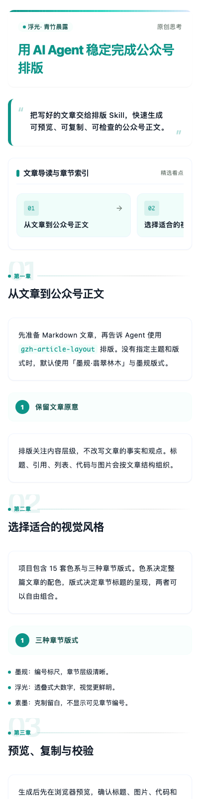
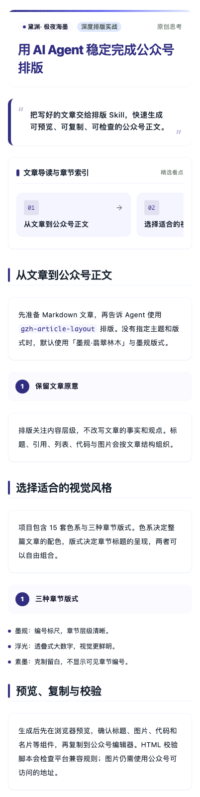
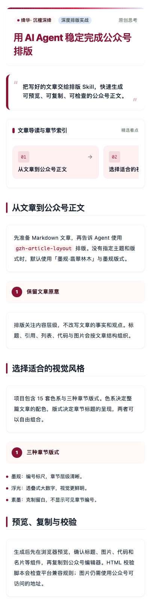
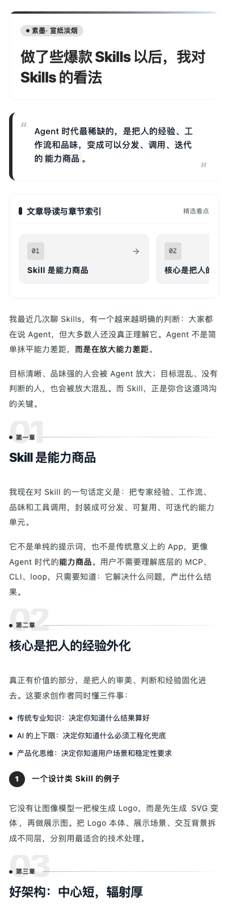
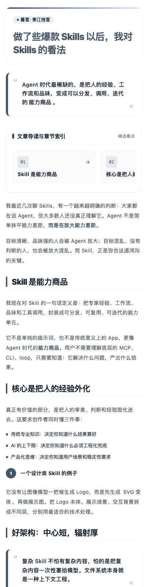

<div align="center">

# gzh-article-layout

**把写好的文章，排成可预览、可复制、可检查的微信公众号正文**

15 套主题色系 × 3 种章节版式 · Markdown / DOCX / PDF / 纯文本 · 离线 HTML 渲染

[快速开始](#快速开始) · [主题预览](#主题预览) · [使用流程](#使用流程) · [功能边界](#功能边界)

</div>

---

`gzh-article-layout` 是面向 AI Agent 的微信公众号文章排版 Skill。提供 Markdown 或文章文件后，Skill 会整理文章结构、应用主题组件并生成适合粘贴到公众号编辑器的 HTML，同时提供浏览器预览和复制入口。

它专注于把已有内容稳定地排版，不代写文章，也不要求用户先了解模板或 HTML。默认主题为 **【墨规】· 翡翠林木**，未指定主题和版式时使用 `emerald + ruler`，无需确认。

## 核心能力

- **15 套内置主题**：覆盖绿色、蓝色、红色、紫色、黑白及暖色等不同视觉方向。
- **3 种章节版式**：墨规 `ruler`、浮光 `overprint`、素墨 `pure`，可与色系自由组合。
- **文章组件排版**：支持标题、引言、章节、引用、列表、表格、代码、图片、GIF、脚注和补充阅读块。
- **公众号 HTML 输出**：使用内联样式，并通过校验脚本检查 HTML 兼容规则。
- **预览与复制**：生成带复制按钮的浏览器预览页，便于发布前检查和粘贴。
- **多格式整理**：Markdown 可直接处理；DOCX、PDF、TXT 和网页文本先整理为 Markdown。
- **主题扩展**：可根据风格描述或参考图创建主题组件库，详见[主题生成规范](references/theme-generator.md)。

## 效果预览

以下 15 张手机尺寸长图均由本项目用同一篇示例文章实际渲染。每套主题采用其登记的默认章节版式；图片仅包含公众号正文，不含浏览器预览工具栏。点击图片可查看原尺寸。

<table>
<tr>
<td align="center"><a href="docs/images/theme-emerald.png"></a><br>墨规·翡翠林木</td>
<td align="center"><a href="docs/images/theme-bamboo-teal.png"></a><br>浮光·青竹晨露</td>
<td align="center"><a href="docs/images/theme-pine-green.png"></a><br>佩兰·寒松冷柏</td>
</tr>
<tr>
<td align="center"><a href="docs/images/theme-mineral-blue.png"></a><br>沧浪·群青深矿</td>
<td align="center"><a href="docs/images/theme-cerulean.png"></a><br>霁蓝·雨过天晴</td>
<td align="center"><a href="docs/images/theme-abyssal-indigo.png"></a><br>黛渊·极夜海墨</td>
</tr>
<tr>
<td align="center"><a href="docs/images/theme-vermilion-seal.png"></a><br>朱印·藏书官印</td>
<td align="center"><a href="docs/images/theme-terracotta.png"></a><br>晚霞·霜林落日</td>
<td align="center"><a href="docs/images/theme-burgundy.png"></a><br>绛华·沉檀深绛</td>
</tr>
<tr>
<td align="center"><a href="docs/images/theme-amber-honey.png"></a><br>琥珀·金石凝光</td>
<td align="center"><a href="docs/images/theme-sandalwood.png"></a><br>古檀·沉香木案</td>
<td align="center"><a href="docs/images/theme-moss-clay.png"></a><br>苍苔·阶前青痕</td>
</tr>
<tr>
<td align="center"><a href="docs/images/theme-imperial-violet.png"></a><br>黛紫·紫气东来</td>
<td align="center"><a href="docs/images/theme-monochrome-zen.png"></a><br>素墨·宣纸淡烟</td>
<td align="center"><a href="docs/images/theme-frost-slate.png"></a><br>暮雪·寒江残雪</td>
</tr>
</table>

查看全部 45 种主题与版式组合：[主题画廊](docs/gallery/index.html) · [主题索引](references/theme-index.md) · [全部组合入口](docs/all-themes.md)。

## 适用场景

**适合**：已经完成初稿，希望生成公众号正文的教程、观点文章、产品盘点、人物访谈、数据报告、案例复盘和生活随笔。

**不适合**：代写文章、普通网页或落地页、PPT、海报图片，以及替用户登录公众号、上传素材、创建草稿或自动发布。

## 快速开始

### 通过 AI Agent 使用

让支持读取本地 Skill 文件的 Agent 加载本项目的 [SKILL.md](SKILL.md)，然后提供文章或文件路径：

```text
使用 gzh-article-layout 将 article.md 排版成微信公众号文章，
生成可复制的预览页并检查输出。
```

默认使用 **【墨规】· 翡翠林木**（`emerald + ruler`）。也可以指定主题、版式和作者信息：

```text
将 article.md 排版成公众号文章。
主题：bamboo-teal；版式：overprint
作者：Jacob
简介：分享产品与工程实践
```

省略主题时采用默认主题；只指定主题时使用该主题登记的默认版式；只指定版式时搭配默认 `emerald` 色系。只有明确要求推荐或比较时，Agent 才按文章题材提供主题建议。

给 DOCX、PDF、TXT 或网页文本时，Agent 会先整理成 Markdown；默认会确认整理后的文章结构。说“直接排”或“一键排版”可跳过结构确认。

### 直接运行离线转换器

项目提供无需第三方 Python 包的 Markdown 转换脚本。在项目根目录运行：

```bash
python3 scripts/render_stitch_article.py article.md \
  --output /tmp/article.html
python3 scripts/validate_gzh_html.py /tmp/article.html
python3 scripts/wrap_preview.py /tmp/article.html
```

打开 `/tmp/article_预览.html`，检查排版后点击“复制到公众号”。转换器省略主题和版式时同样使用 `emerald + ruler`。

| 参数 | 说明 |
|---|---|
| `--theme` | 主题 ID，默认 `emerald` |
| `--layout` | `ruler`、`overprint` 或 `pure` |
| `--author` / `--bio` | 作者名和简介 |
| `--qr-url` | 真实二维码图片地址；未提供时不使用二维码 |
| `--list-themes` | 列出内置主题 |

DOCX 可先提取为 Markdown：

```bash
python3 scripts/extract_docx.py article.docx -o article.md
```

## 使用流程

1. 提供文章或文章文件；非 Markdown 输入先整理为 Markdown。
2. 指定主题与版式，或采用默认的 `emerald + ruler`。
3. 按文章结构装配主题组件，生成正文 HTML 和浏览器预览。
4. 运行 HTML 校验，检查预览并复制到公众号编辑器。

常见 Markdown 标记：`**加粗**`、`==高亮==`、`++关键词下划线++`、`~~删除线~~`，以及 `::: warning`、`::: info`、`::: tip`、`::: quote` 扩展块。直接运行转换器时，语义分析由用户准备；Agent 工作流可按文章内容识别关键词。

## 项目文档

- [Skill 工作流](SKILL.md)
- [产品使用指南](docs/product-guide.md)
- [主题索引](references/theme-index.md)
- [格式归一化规则](references/format-normalize.md)
- [自定义主题生成规范](references/theme-generator.md)
- [设计来源与公众号适配说明](references/stitch-design-system.md)

## 功能边界

- 项目负责排版，不撰写文章、不上传图片，也不连接或操作公众号账号。
- 图片和二维码需使用目标环境可以访问的地址；本地图片不会自动上传。
- HTML 已按项目校验规则生成，但不同公众号编辑器版本、微信客户端和深色模式可能造成显示差异。正式发布前请在目标编辑器中粘贴检查。
- 离线转换器直接处理 Markdown；PDF、TXT 和网页文本的结构整理由 Agent 工作流完成。

## 许可

项目许可与版权声明见 [LICENSE](LICENSE)。随附图标的来源和许可见[图标说明](assets/stitch/icons/NOTICE.md)。
